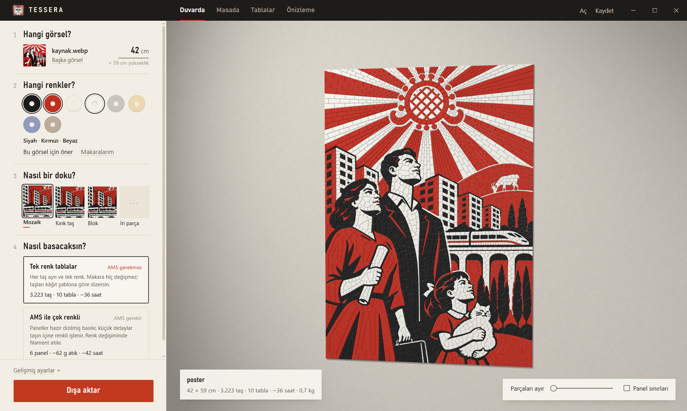
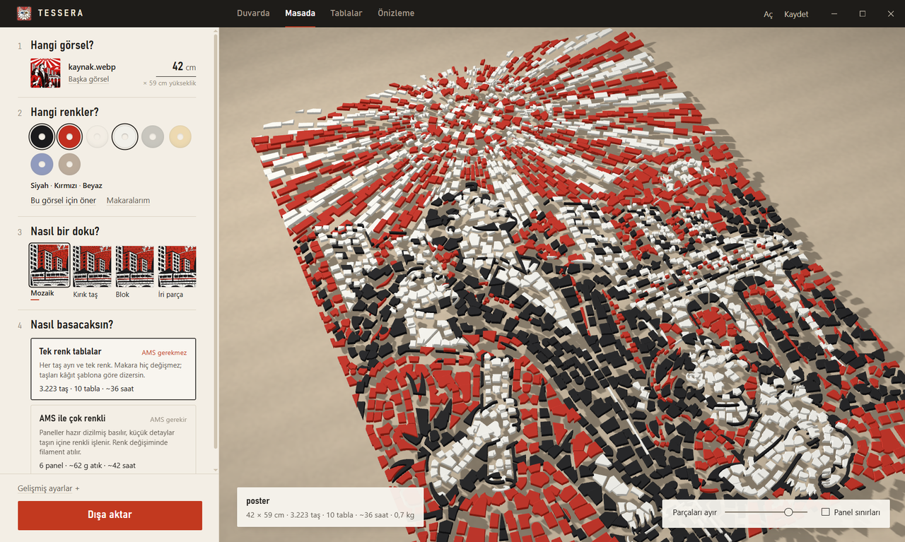

# Tessera

Bir görseli, taşlarını tek tek 3D yazıcıdan basabileceğin bir mozaiğe çeviren Windows programı.



- **Resmi taşın kesimi çizer.** Göz, dudak, pencere kendi biçiminde tek taş olarak kesilir; büyük alanlar konturu izleyen taş sıralarına bölünür.
- **Her taş tek renk ve ayrı bir model.** Renk sınırı her zaman kesim yeridir. Taşın içinde renk yalnızca AMS modunda değişir.
- **Derz ve arka levha gerekmez.** Taşlar 1:1 kâğıt şablona göre duvara ya da levhaya yapıştırılır.
- **Parça sayısını sen seçersin.** 10 cm'lik 20 parçalık bir iş de olur, binlerce taşlık bir duvar da.
- **İstersen tek parça taban.** Çizgi rengi, taşların oturduğu yuvalı tabana dönüşür.
- **Kırpma ve şekil:** düz, yuvarlak köşe, daire, oval.
- **Arka planı kaldırma:** çizim, logo ve afişlerde düz renkli arka plan kalkar, eser kendi dış çizgisiyle kesilir. Tıklayarak düzeltilir. Fotoğraflarda da denenebilir (deneme aşamasında): yeşil "kalsın", kırmızı "gitsin" çizgileriyle yönlendirilir.
- **Dört doku:** Mozaik, Kırık taş, Blok, İri parça.
- **Çıktı:** Bambu Studio 3MF tablaları (renk renk ya da AMS panelleri), her taşın STL'i, A4/A3 montaj şablonu, kılavuz.



## Kurulum

Windows, Python 3.12 ya da üstü:

```powershell
py -m venv .venv
.venv\Scripts\python -m pip install -r requirements.txt
```

Sonra `Tessera.bat`. Kullanım: [NASIL_KULLANILIR.md](NASIL_KULLANILIR.md)

Testler:

```powershell
$env:QT_QPA_PLATFORM="offscreen"; $env:PYTHONPATH="."; .venv\Scripts\python -m pytest -q
```

## Durum

Dilimleme Bambu Studio (X1C profili) ile denendi; gerçek baskı denemesi henüz yapılmadı.

3D sahne [three.js](https://threejs.org) kullanır (MIT lisansı).
